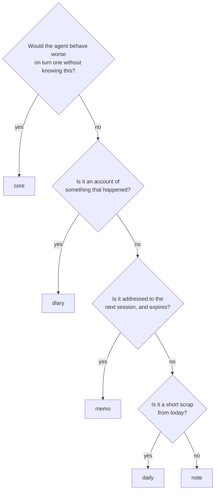

# Memory model

How entries are classified, tagged and rolled up, and how to wire an agent to the store.
[README](../README.md) explains *why* the design looks like this; [design.md](design.md) argues
the trade-offs. This page is the operating manual.

---

## 1. Data model

One table, one file.

| column | meaning |
|---|---|
| `id` | autoincrement; also the tie-breaker whenever ordering matters |
| `content` | the entry itself, free text |
| `layer` | exactly one of the configured layers |
| `tags` | comma-separated free text. **The first tag is the grouping key for sinking** (see §3) |
| `source` | who wrote it (`agent` by default) |
| `created_at`, `updated_at` | UTC. Convert to local time before grouping by day |
| `active_flag` | `1` = hot, loaded on wake-up. `0` = sunk: still searchable, no longer auto-loaded |

There is no versioning: `update_memory` overwrites.

---

## 2. What goes in each layer

A layer answers one question: **when does this entry get loaded?** Everything else follows from
that.

| layer | holds | loaded | lifetime |
|---|---|---|---|
| `core` | who the user is, standing preferences, environment facts, operating rules, and the rolling summaries | every session, automatically | permanent; only summaries sink |
| `diary` | what happened: one narrative entry per day or session, with decisions *and the reasons* | the N most recent at wake-up, the rest by search | permanent; the raw material for summaries |
| `daily` | quick fragments written during the day, no ceremony | by search | permanent, low value per entry |
| `memo` | hand-offs to the next session, and pointers saying where things live | by explicit read | short; demote or delete once acted on |
| `note` | reference material that is long or situational: drafts, worked analyses, documents | by search | permanent |

To decide where an entry goes, ask in this order and stop at the first yes:



Two rules keep this honest:

- **`core` is not an archive.** The first question is a test, not a preference. If you cannot
  say what the agent would get wrong without the entry, it does not belong there. Wake-up cost is
  the size of `core`, and every entry you add makes every future session slower and noisier.
- **Layers are configuration, roles are not.** Rename them freely, but keep the five roles.
  `wakeup` reads `core` and the diary layer by name, and `core` is the only layer that ships with
  a hot limit, but sinking itself is not special to `core`: any layer can be given a cap in
  `hot_limits` (see §3).

---

## 3. Tags

`tags` is free text, comma-separated. Two things in the code read it:

1. **Sinking.** When an entry is written, the store takes its *first* tag, finds the entries in
   the same layer whose tags contain it, and keeps only the newest `hot_limits[layer]` of them
   hot. The rest get `active_flag = 0`. Only layers listed in `hot_limits` are capped, and the
   default config lists just `core`; add `"diary": 30`, say, and a tagged diary layer sinks too.
   An entry with no tag is never counted.
2. **Search and read filters.** Both match tags as a substring.

Conventions that follow from that:

- The **first tag says what kind of entry this is** (`profile`, `preferences`, `environment`,
  a summary tag). Everything after it is free: dates, topics, names.
- **Untagged entries are never capped.** That is how `core` holds an unbounded number of
  permanent facts next to a fixed number of hot summaries: tag the summaries, leave the facts
  without a tag, or give them a first tag that has no cap.
- **No first tag may contain another.** Matching is a substring test, so `digest` also matches
  `digest-weekly`, and writing one will sink the other. Pick names like `tenday`, `monthly`,
  `quarterly` that cannot overlap.

---

## 4. Rolling summaries

Cold sinking only works if something produces the summaries. The store never writes them; the
agent does, on a schedule you choose.

1. When enough diary has accumulated since the last summary (ten days is a reasonable default),
   read it: `read_memory` with `layer=diary`.
2. Write **one** entry into `core` tagged with the summary tag, for example
   `tags="tenday,2026-03-01..2026-03-10"`.
3. The store applies the hot limit. With `{"core": 2}` the two newest ten-day summaries stay hot
   and everything older sinks, still searchable.

A summary that lists what happened is half a summary. Write down **what was decided and why**,
what is still open, and anything the user said that should change how the agent behaves. The
reasons are what the raw diary would have told you, and they are the part that is expensive to
reconstruct later (see design.md §2).

A shape that works:

```
Period: 2026-03-01 to 2026-03-10
Decisions: moved the nightly backup to 03:00 — the midnight run collided with log rotation.
Open: disk alerts still fire at 80%; threshold not yet reviewed.
Behaviour: user prefers short status updates; stop offering long option lists.
```

**Several levels.** Use a separate first tag per level and give each its own cap:
ten-day summaries written from the diary, monthly summaries written from the ten-day ones,
quarterly from the monthly ones. Each tag keeps its own newest two hot, so wake-up always carries
the most recent ten-day, monthly and quarterly view, six records covering several months, and the
count does not grow.

---

## 5. Wiring up an agent

### 5.1 Run the server

```bash
cp config.example.json config.json
MNEMO_TOKEN=$(python -c "import secrets;print(secrets.token_urlsafe(32))") python -m mnemo.server
```

Bind to `127.0.0.1` and put a TLS-terminating reverse proxy in front. The token is the last path
segment of the URL, so the full endpoint is `https://your-host/<token>`.

### 5.2 Register it as an MCP server

Add `https://your-host/<token>` as a remote MCP server in your client. To check by hand, the
server speaks JSON-RPC 2.0 over HTTP POST:

```bash
URL=https://your-host/<token>

# what tools are there
curl -s -X POST $URL -H 'Content-Type: application/json' \
  -d '{"jsonrpc":"2.0","id":1,"method":"tools/list"}'

# store a permanent fact
curl -s -X POST $URL -H 'Content-Type: application/json' \
  -d '{"jsonrpc":"2.0","id":2,"method":"tools/call","params":{"name":"write_memory","arguments":{"layer":"core","tags":"profile","content":"Prefers concise answers."}}}'

# what an agent receives at the start of a session
curl -s -X POST $URL -H 'Content-Type: application/json' \
  -d '{"jsonrpc":"2.0","id":3,"method":"tools/call","params":{"name":"wakeup","arguments":{}}}'
```

A wrong or missing token returns 401.

### 5.3 Tell the agent to use it

This is the one part the store cannot do for itself: **nothing in the store can make the agent
call the store.** The instruction has to live in the agent's standing instructions, the system
prompt or the project or user preferences of whatever client you use. Something like:

```
At the start of every session, before replying, call `wakeup`.
Before the session ends or the context fills, write a diary entry with `write_memory`
(layer=diary): what happened, what was decided and why, what is unresolved.
When the user states a lasting fact or preference, write it to core without asking.
When you need something that was not loaded, call `search_memory` with a few distinctive words.
```

Keep it short and put `wakeup` first. A long instruction is a skipped instruction, which is the
same lesson as design.md §3.

### 5.4 Check that it works

Open a fresh session and say nothing about yourself. If the agent already knows something that
only exists in `core`, wake-up is wired correctly. If it does not, the instruction in §5.3 is
not being followed, and the store is not the problem.
